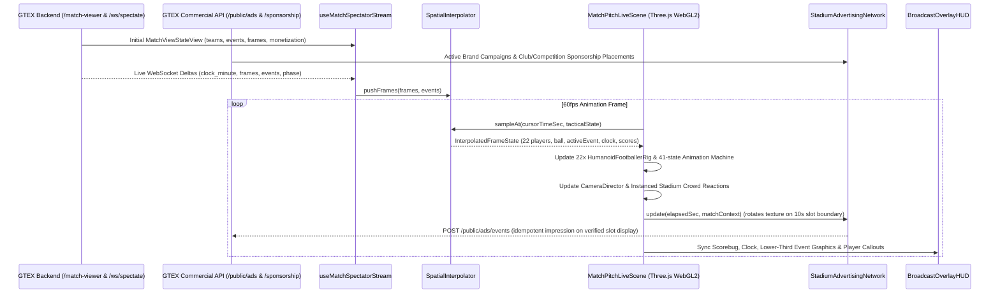

# GTEX WebGL Matchday 3D — Canonical Browser Architecture

**Status:** Approved & Active  
**Canonical Browser Renderer:** React WebGL 2D orthographic pitch (`frontend/react-shell/src/match2d`)  
**Authoritative Match Engine:** GTEX Backend (`backend/app`)  

---

## 1. Executive Architecture Decision

The **React WebGL 2D** orthographic pitch in `frontend/react-shell/src/match2d` is the **launch browser match**. Perspective `MatchPitchLiveScene` remains optional later and is not the default.

### Platform Role Matrix

| Platform | Official Role | Codebase Location |
|---|---|---|
| **React WebGL 2D** | **Launch browser match** (orthographic pitch, procedural players, authoritative snapshots). | `frontend/react-shell/src/match2d` |
| **GTEX Backend** | **Authoritative football match simulation, events, score, clock, fairness proofs, and commercial ad/sponsorship delivery** | `backend/app/match_engine/`, `backend/app/routes/match_viewer.py`, `backend/app/ads_engine/`, `backend/app/sponsorship_engine/` |
| **React + Three.js perspective** | Optional later picture (stadium, broadcast cameras, HUD). It is not the default match. | `frontend/react-shell/src/lib/3d/broadcast/` |
| **Unity** | **Existing separate desktop/historical visual runtime** (preserved historical engineering assets; not the browser match renderer) | `unity/`, `Gtex_Test_Migration/` |

---

## 2. Core Architectural Principles

1. **Strict Separation of Simulation Authority and Browser Presentation:**
   - **GTEX Backend Simulation → Authoritative Match Event/State Stream → React/WebGL Match Presentation → Stadium & Broadcast Graphics.**
   - The browser renderer never decides match outcomes, goals, cards, substitutions, or final scores. All scores, clocks, and match events are derived strictly from the authoritative backend contract (`SpectatorSafeMatchView` / `MatchViewStateView`).
2. **Single Canonical Browser Scene (`MatchPitchLiveScene`):**
   - All 3D browser match rendering builds on `MatchPitchLiveScene`, `StadiumArenaEnvironment`, `StadiumAdvertisingNetwork`, `HumanoidFootballerRig`, `FootballAnimationStateMachine`, `CameraDirector`, `BroadcastOverlayHUD`, and `SpatialInterpolator`.
   - No competing browser 3D scenes, duplicate playback engines, or secondary scoreboard authorities are permitted.
3. **Commercial Integrity in Stadium LED Advertising:**
   - Stadium perimeter LED boards (`StadiumAdvertisingNetwork`) consume real GTEX advertising and sponsorship data (`/public/ads/campaigns`, `/sponsorship/placements`, `MatchViewerMonetizationView`, and club/competition sponsorship contracts).
   - Expired, unapproved, paused, or budget-exhausted campaigns are never displayed. When no external campaign is active, the boards fall back cleanly to official GTEX house creatives.
   - Campaign rotations occur on configurable slot boundaries (`10s` default) without per-frame texture or material allocations, and verified impressions are reported through the approved idempotent `/public/ads/events` endpoint.

---

## 3. Data Flow & Component Architecture

---

## 4. Component Responsibilities

### 4.1 `useMatchSpectatorStream.ts` & `spectatorContract.ts`
- Validates and normalizes `MatchViewStateView` payloads from `GET /match-viewer/{id}` and live WebSocket frames from `/ws/spectate/{match_id}`.
- Handles reconnection with exponential backoff and gap-free HTTP catch-up via `/match-viewer/{id}`.
- Explicitly distinguishes live/persisted competition fixtures from deterministic showcase/demonstration fixtures (`isDemonstrationFixture`).

### 4.2 `SpatialInterpolator.ts`
- Buffers authoritative `SpectatorTimelineFrame` snapshots and synthesizes 60fps Catmull-Rom spline paths for all 22 players.
- Computes physical ball flight trajectories: close-control dribbling synced to stride phase, ground pass turf friction deceleration, lofted ballistic trajectories with gravity (`9.81 m/s²`) and Magnus lift, and turf bounce restitution.
- Applies bounded visual tactical modulation (`formation`, `defensive_line`, `press_intensity`, `compactness`, `width`) so live tactical changes are visually expressed on the 3D pitch without overriding authoritative event outcomes.

### 4.3 `HumanoidFootballerRig.ts` & `FootballAnimationStateMachine.ts`
- Loads `/assets/3d/footballers/gtex_humanoid_footballer.glb` (26-bone `SkinnedMesh` with procedural fallback) for 22 distinct footballers (11 Home, 11 Away, 2 Goalkeepers in distinct kits/gloves).
- Evaluates 41 procedural skeletal animation states across locomotion, turning, passing, receiving, dribbling, shielding, shooting, volleys, headers, standing/sliding tackles, blocks, goalkeeper dives/catches/punches/distribution, and celebrations/reactions with quaternion slerp cross-fading and ground-contact foot planting.

### 4.4 `StadiumArenaEnvironment.ts` & `StadiumAdvertisingNetwork.ts`
- Builds the regulation `105m x 68m` grass pitch, markings, goals/nets, 4-stand stadium bowl, roof trusses, corner floodlight towers, dugouts, and stadium jumbotrons.
- Renders an efficient `THREE.InstancedMesh` supporter crowd styled with home/away club colours that reacts dynamically to match events (goals, saves, near misses, attacks, red cards, final whistle).
- Drives the physical 3D perimeter LED advertising boards (`StadiumAdvertisingNetwork`) with high-resolution `2048x256` multi-slot textures angled toward the main broadcast camera, campaign eligibility/schedule filtering, 10-second slot rotation, house fallback creatives, and idempotent impression telemetry.

### 4.5 `CameraDirector.ts` & `BroadcastOverlayHUD.tsx`
- Provides 6 television broadcast camera modes: **Main Broadcast**, **Tactical Wide**, **Attacking**, **Goal**, **Replay**, and **Celebration**, with smooth critical-damped tracking and automatic event-driven cutaways in Director mode.
- Renders the broadcast scorebug (home/away club crests, team names, authoritative score, authoritative match clock `clock_minute`, match phase, competition identity, and `DEMONSTRATION FIXTURE` badge when applicable), rich lower-third event graphics (Goals, Cards, Substitutions, Penalties, Injuries, HT/FT, VAR), active player identification bar, and replay status indicator.
