# GTEX Club Dynasty Phase 2.1 — Visual & Technical Evidence Directory

This directory contains the canonical visual verification screenshots, Before-and-After comparisons, the 28-Model Production GLB Architectural Contact Sheet, and the PR #378 GLB Integrity Audit output for **GTEX Club Dynasty Phase 2.1** (`gemini/gtex-phase2-1-campus-builder`, incorporating PR #379).

---

## 1. Before-and-After Visual Comparisons

### A. Daylight Campus Overview: Phase 1 (2D Canvas Projection) → Phase 2 (Initial Low-Poly WebGL) → Phase 2.1 (High-Detail Multi-Material PBR WebGL 3D)

| Stage | Screenshot |
| :--- | :--- |
| **Before (Phase 1):** Custom 2D HTML5 Canvas isometric projection (no WebGL renderer or GLB loading) | 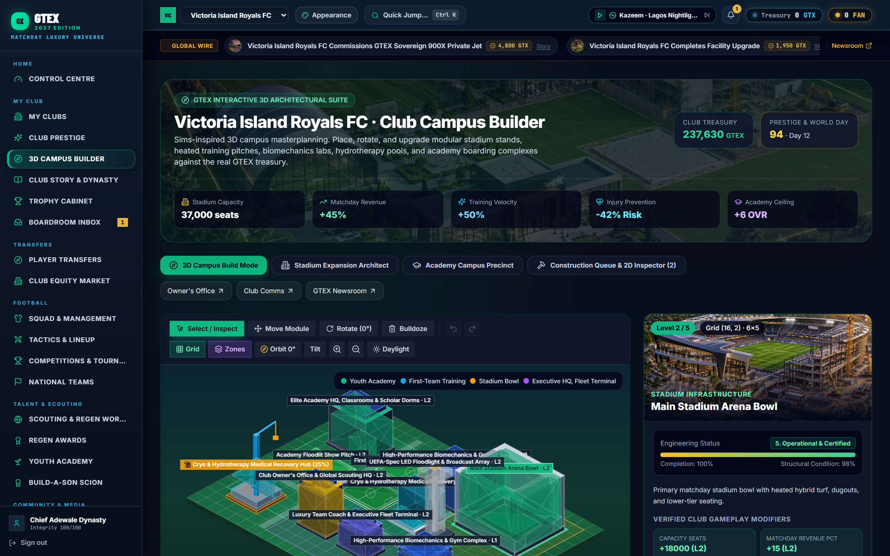 |
| **Before (Phase 2 Initial):** First Three.js WebGL pass with low-poly procedural GLB boxes | 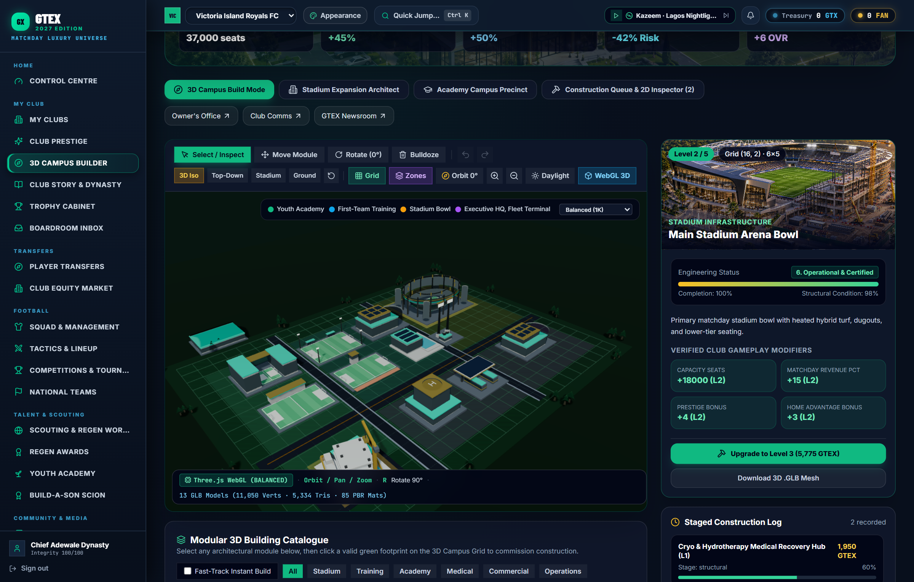 |
| **After (Phase 2.1 Final):** High-detail multi-material PBR WebGL 3D Campus with cable-stayed stadium roof trusses, East Broadcast Media Superstructure, mullioned glass facades, and clarified 6-card KPI strip | 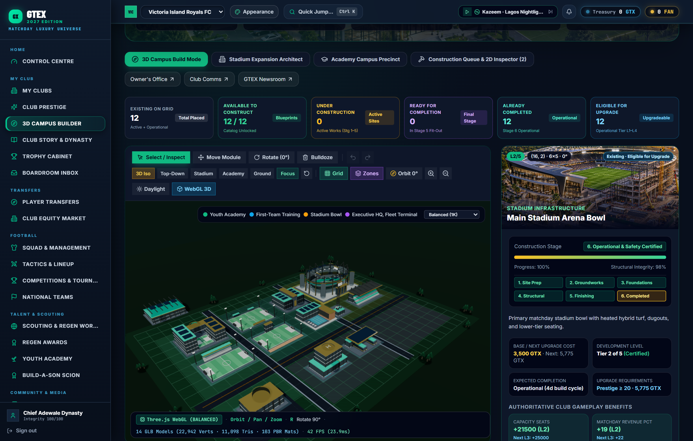 |

### B. Night Floodlights Mode: Initial Dim Pass → Phase 2.1 Calibrated 4-Rig Stadium & Precinct Floodlight Illumination

| Stage | Screenshot |
| :--- | :--- |
| **Before (Initial Night Pass):** Low-intensity point lights (`intensity=2.2`) left ground and facades dark under physical light decay | 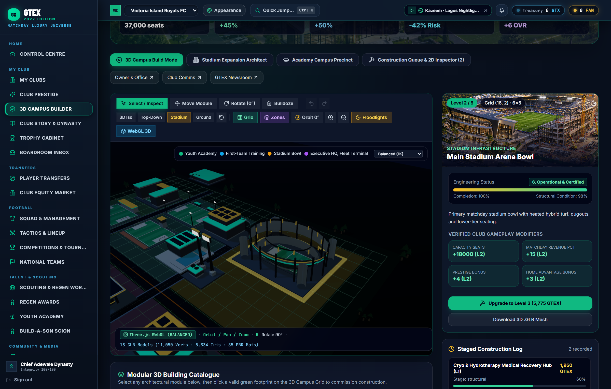 |
| **After (Phase 2.1 Calibrated Night Mode):** 4 high-output physical `PointLight` rigs (`stadiumSpot1`, `stadiumSpot2`, `hqSpot`, `academySpot`) + cool moonlight fill (`0x93c5fd`) illuminating turf stripes, seating bowl, glass facades, and roads | 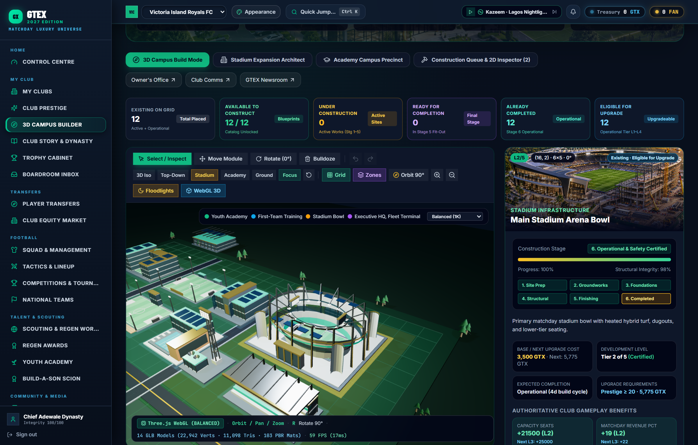 |

---

## 2. 28 Production GLB Models — Architectural Contact Sheet (`4 × 7` Studio Renders)

All 28 production `.glb` assets from `frontend/react-shell/public/models/campus/*.glb` rendered individually via Three.js `WebGLRenderer` + `GLTFLoader` on their exact `(W × D)` grid footprint plinths:

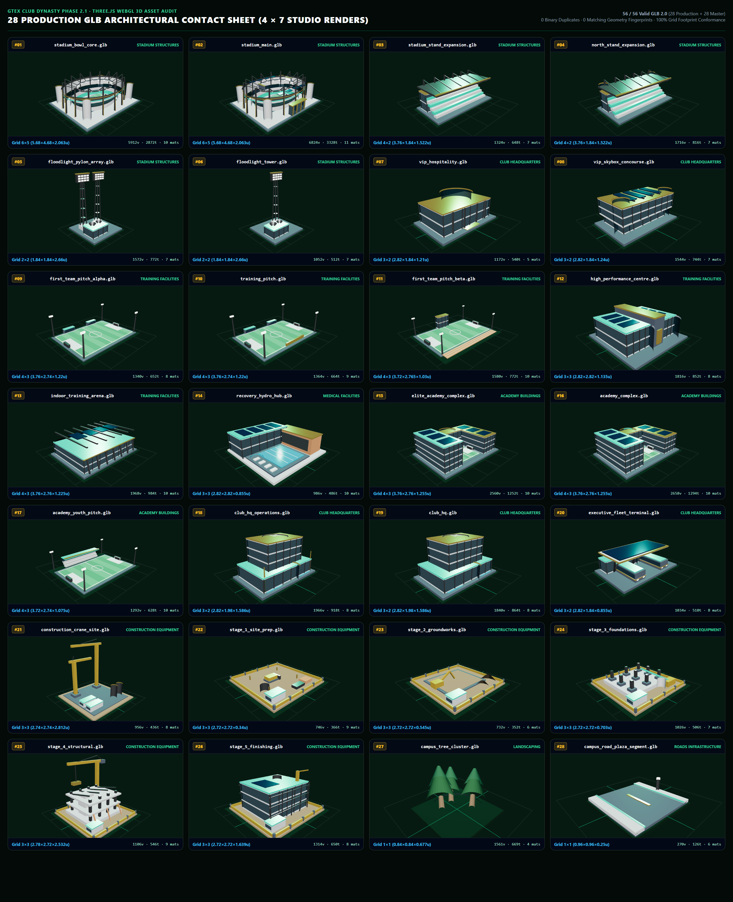

- **GLB Integrity Audit ([`campus_glb_audit_report.md`](./campus_glb_audit_report.md)):**
  - **Files Audited:** `56` (`28` production `.glb` + `28` high-segment `.master.glb`)
  - **Valid GLB 2.0:** `56 / 56` (`0` invalid, `0` warnings, `0` errors)
  - **Exact Binary Duplicates:** `0`
  - **Matching Geometry Fingerprints:** `0`
  - **Same Metrics Only Groups:** `0`

---

## 3. Complete 8-Screenshot Phase 2.1 Browser Verification Suite

1. **`phase2_1_01_daylight_campus_overview.png` — Daylight 3D Isometric Overview:**
   

2. **`phase2_1_02_night_campus_overview.png` — Night Floodlights Stadium Aerial Overview:**
   

3. **`phase2_1_03_ground_level_stadium_inspection.png` — Ground-Level Stadium Inspection:**
   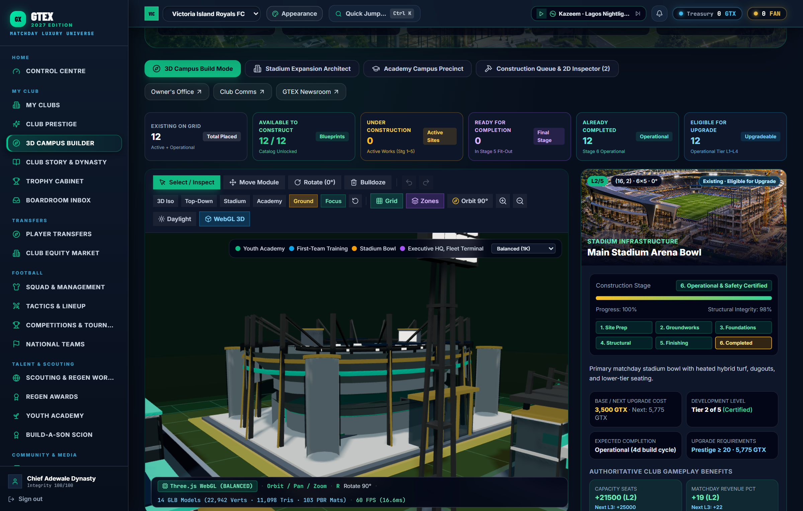

4. **`phase2_1_04_academy_precinct_inspection.png` — Elite Academy & High-Performance Precinct Inspection:**
   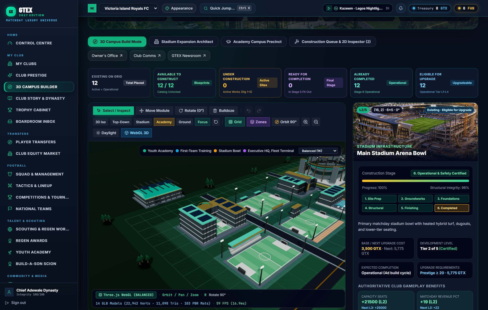

5. **`phase2_1_05_valid_placement_preview.png` — Raycasted Build Mode Ghost Preview & `90°` Rotation Validation:**
   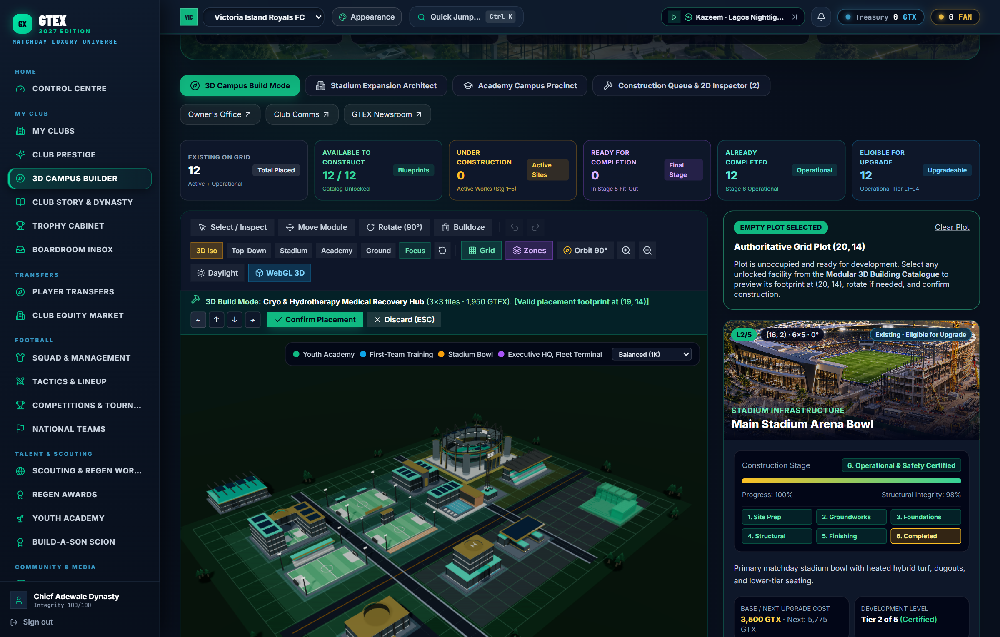

6. **`phase2_1_06_active_construction_stages.png` — Active Construction Lifecycle Progression (Stage 5 Finishing Fit-Out):**
   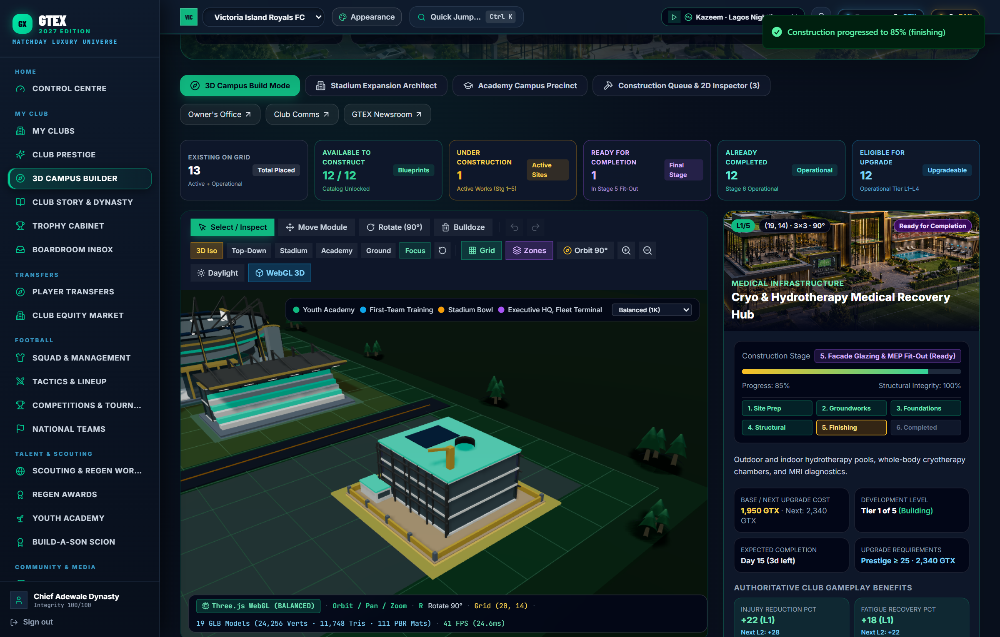

7. **`phase2_1_07_completed_construction_persisted.png` — Completed Operational Facility Persisted After Page Refresh:**
   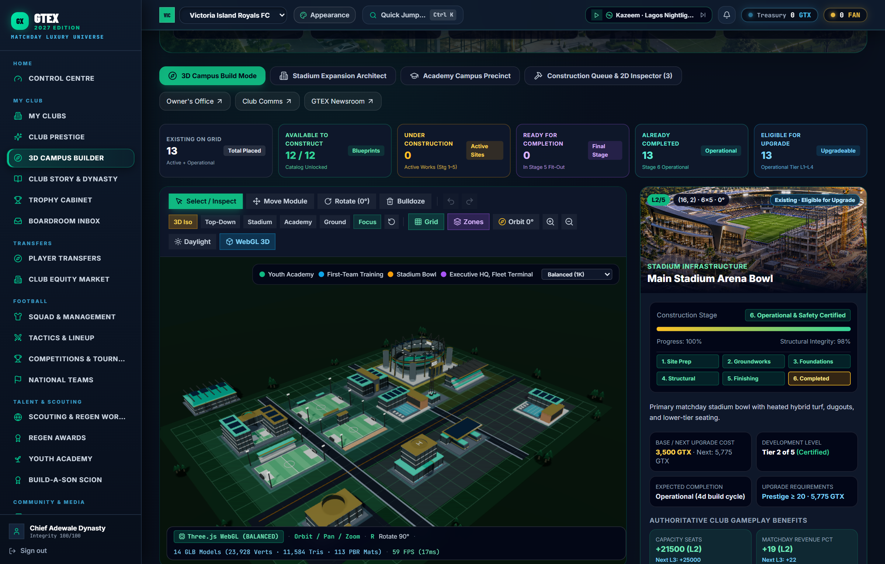

8. **`phase2_1_08_individual_facilities_showcase.png` — Full 14-Facility Campus Showcase (All 12 Blueprints Represented):**
   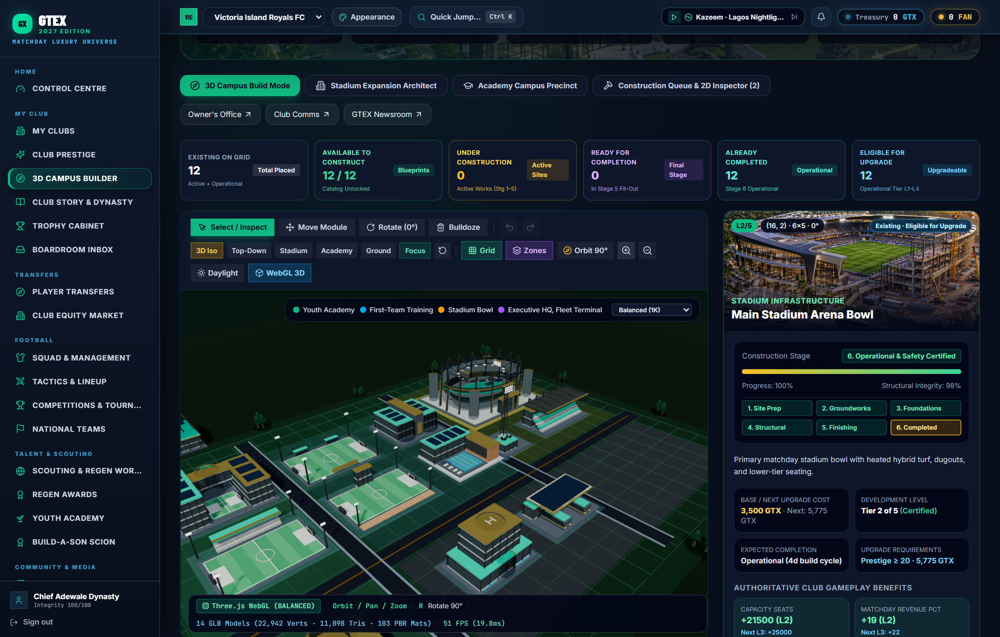
