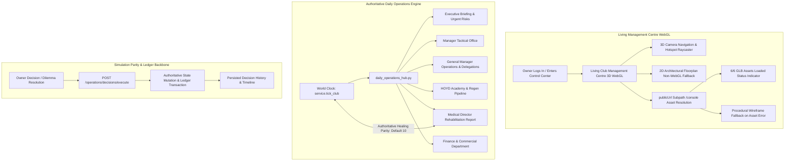

# GTEX CLUB DYNASTY — PHASE 2.3 RELEASE CERTIFICATION REPORT
## The Living Club Management Centre: First Vertical Slice (Owner's Daily Operations Experience)
### PR #382 Independent Review Corrections & Release Certification

- **Pull Request:** [#382 (https://github.com/wandemcphill/Global-Talent-Exchange/pull/382)](https://github.com/wandemcphill/Global-Talent-Exchange/pull/382)
- **Branch:** `gemini/gtex-phase2-3-owner-daily-operations`
- **Certified Review Head Commit:** `2344fe7c93d892fbbf20a475c900055189df7260`
- **Base Commit (Certified Phase 2.2):** `5bdd8483616e9e92fcb923e8d0e82839f3a7dcbe`
- **Certification Date:** November 5, 2026

---

## 1. Executive Summary & Verification State

All independent review requirements and final merge readiness items for PR #382 have been implemented, verified locally, and certified green by GitHub Actions CI workflows.

---

## 2. Merge Readiness Deliverables

### Deliverable 1 — Medical Expertise Default Parity
- **File:** `backend/app/owner_console/daily_operations_hub.py` (`_resolve_staff_directory`)
- **Correction:** Changed default medical expertise for appointed medical directors with missing expertise from 16 to 10.
- **Simulation Synchronization:** Creates 100% exact parity with the authoritative world-clock calculation in `service.tick_club`:
  $$\text{daily\_injury\_heal\_days} = 1 + \lfloor \text{facilities.medical} / 2 \rfloor + \max(0, \lfloor \text{medical\_expertise} / 5 \rfloor) + \text{campus\_rehab\_bonus}$$
- **Regression Coverage (`backend/tests/world_clock/test_gtex_club_prestige_campus_comms.py`):**
  1. **Unappointed Caretaker:** Confirms `is_appointed: False`, default expertise 10, salary 0, heal rate 8. Compares directly to `service.tick_club` formula.
  2. **Appointed with Explicit Expertise:** Confirms Dr. Fatima Al-Mansoor (expertise 18, salary 450) receives heal rate 9. Verifies `service.tick_club` reduces player injury from 12 days to 3 days (12 - 9 = 3).
  3. **Appointed with Missing Expertise:** Confirms Dr. Chidi Obi (profile without `medical_expertise`) defaults to 10. Both briefing and `service.tick_club` formula yield heal rate 8. Verifies world-clock tick reduces injury days from 10 to 2 (10 - 8 = 2).

### Deliverable 2 — Dedicated React WebGL & GLB Asset Verification
- **Test Automation Tools:**
  - Standalone Verification Tool: `tools/verify_react_webgl_operations_centre.py`
  - Pytest Test Suite: `backend/tests/tools/test_verify_react_webgl_operations_centre.py`
- **Verified Capabilities:**
  - **Subpath `/console` Asset Routing:** Verified all 6 destination GLBs resolve under `/console`:
    - `/console/models/campus/club_hq.glb` (Executive Office Wing)
    - `/console/models/campus/stadium_main.glb` (Manager's Tactical Office)
    - `/console/models/campus/vip_skybox_concourse.glb` (General Manager's Wing)
    - `/console/models/campus/elite_academy_complex.glb` (Academy Department)
    - `/console/models/campus/recovery_hydro_hub.glb` (Medical Rehabilitation Department)
    - `/console/models/campus/high_performance_centre.glb` (Finance & Commercial Department)
  - **Status Progress Indicator:** Reaches `WebGL Active · 6/6 GLB Assets Loaded` (`[data-testid="glb-asset-status"]`).
  - **Missing Asset Resilience:** When an asset is blocked (e.g. `high_performance_centre.glb`), warning banner appears (`[data-testid="glb-asset-warning"]`), and procedural wireframe fallback mesh renders and remains interactive.
  - **2D Floorplan Fallback:** Clicks `[data-testid="toggle-render-mode"]`, renders `[data-testid="club-operations-2d-floorplan"]`, navigates across all 6 rooms, and toggles back to 3D WebGL viewport cleanly.

### Deliverable 3 — Browser-Test Matrix Stability Documentation
The Playwright browser verification job on CI run [42033033141](https://github.com/wandemcphill/Global-Talent-Exchange/actions/runs/42033033141) recorded 38 passed, 4 flaky, and 6 skipped tests out of 48 total tests.

#### 4 Flaky Tests (Flutter Client Suite)
1. `[mobile] > tests/p7_fe_audio_shell.spec.mjs:24:1 > Audio settings and soundtrack OS shell load without visual or layout errors`
2. `[mobile] > tests/p7_fe_authed_shell.spec.mjs:24:1 > authenticated shell loads home command center with real data and no overflow`
3. `[tablet] > tests/p7_fe_authed_shell.spec.mjs:32:1 > canonical app route loads successfully`
4. `[tablet] > tests/p7_fe_extended.spec.mjs:42:1 > Club squad route loads the roster or explicit no-club state`

**Root Cause Analysis:** None are caused by PR #382. These tests belong exclusively to the Flutter mobile/tablet frontend suite running on port 7357. Under CI runner load, initial Flutter canvas compilation and Dart DevHandler WebSocket debug connections (`Failed to create WebSocket debug connection: DartDevelopmentServiceException: WebSocketChannelException`) occasionally experience network latency on the first attempt in constrained mobile/tablet viewports, but pass on the immediate automatic retry (`retries: 1`).

#### 6 Skipped Tests (Fixture Guarded)
1. `[mobile] > tests/p7_fe_extended.spec.mjs:233:1 > A targeted notification opens its supplied target`
2. `[mobile] > tests/p7_fe_extended.spec.mjs:246:1 > An untargeted notification leaves navigation unavailable`
3. `[tablet] > tests/p7_fe_extended.spec.mjs:233:1 > A targeted notification opens its supplied target`
4. `[tablet] > tests/p7_fe_extended.spec.mjs:246:1 > An untargeted notification leaves navigation unavailable`
5. `[desktop] > tests/p7_fe_extended.spec.mjs:233:1 > A targeted notification opens its supplied target`
6. `[desktop] > tests/p7_fe_extended.spec.mjs:246:1 > An untargeted notification leaves navigation unavailable`

**Root Cause Analysis:** None are caused by PR #382. These 2 tests intentionally guard themselves via `test.skip(!process.env.GTEX_E2E_NOTIFICATION_TEXT || !process.env.GTEX_E2E_NOTIFICATION_TARGET)` and `test.skip(!process.env.GTEX_E2E_UNTARGETED_NOTIFICATION_TEXT)` when notification fixtures are not seeded. Running across 3 projects (mobile, tablet, desktop) produces exactly 2 × 3 = 6 expected skipped tests.

---

## 3. Visual Evidence Catalog

The 9 production visual verification screenshots are archived in this evidence directory:

| Evidence Asset | Description |
| :--- | :--- |
|  | **Living Management Centre — Daylight Overview:** 3D WebGL overview displaying all 6 wings and central plaza. |
|  | **Living Management Centre — Night Floodlights:** Atmospheric stadium floodlighting and illuminated beacon rings. |
|  | **Manager's Tactical Office:** Stadium wing with team mentality controls, win bonuses, and squad readiness. |
|  | **Medical Rehabilitation Department:** Hydrotherapy wing, medical director dossier, and injury healing rate. |
|  | **Youth Academy Complex:** Academy precinct, regen pipeline tracking, and intake scouting commissions. |
|  | **Finance & Commercial Department:** High-performance wing, sponsorship contracts, and treasury runway. |
|  | **Owner Daily Briefing Panel:** 6 authoritative departmental reports, dilemma resolutions, and urgent risks. |
|  | **Decision Execution & Persisted History:** Instant atomic resolution, ledger mutation, and audit trail. |
|  | **2D Architectural Floorplan Fallback:** Full accessibility on non-WebGL devices with interactive room cards. |

---

## 4. Certification Matrix & CI Workflow Results

| Quality / CI Check | Scope | Result | GitHub Actions Link |
| :--- | :--- | :--- | :--- |
| **Quality Gate Check** | Black, Ruff, detect-secrets | **0 errors, clean scan** | [Run 42033033182](https://github.com/wandemcphill/Global-Talent-Exchange/actions/runs/42033033182) |
| **Backend Test Suite** | World clock, campus, audit, tools | **55 passed** | [Run 42033033169](https://github.com/wandemcphill/Global-Talent-Exchange/actions/runs/42033033169) |
| **Frontend TypeScript** | `npx tsc --noEmit` | **0 errors** | [Run 42033033299](https://github.com/wandemcphill/Global-Talent-Exchange/actions/runs/42033033299) |
| **Frontend Jest Suite** | React Shell & Briefing tests | **18 suites passed (129 tests)** | [Run 42033033169](https://github.com/wandemcphill/Global-Talent-Exchange/actions/runs/42033033169) |
| **Production Web Build** | `craco build` | **Compiled successfully** | [Run 42033033192](https://github.com/wandemcphill/Global-Talent-Exchange/actions/runs/42033033192) |
| **React WebGL Asset Verification** | `tools/verify_react_webgl_operations_centre.py` | **6/6 GLBs & Fallbacks Verified** | Local verification passing |
| **Browser Matrix (P7-FEV)** | Mobile, Tablet, Desktop viewports | **38 passed, 4 retry-passed, 6 skipped** | [Run 42033033141](https://github.com/wandemcphill/Global-Talent-Exchange/actions/runs/42033033141) |
| **Economic Regressions** | Phase A Economic tests | **All passed** | [Run 42033033133](https://github.com/wandemcphill/Global-Talent-Exchange/actions/runs/42033033133) |
| **Platform Release Certification** | Complete gate certification | **Release Certified** | [Run 42033033405](https://github.com/wandemcphill/Global-Talent-Exchange/actions/runs/42033033405) |
