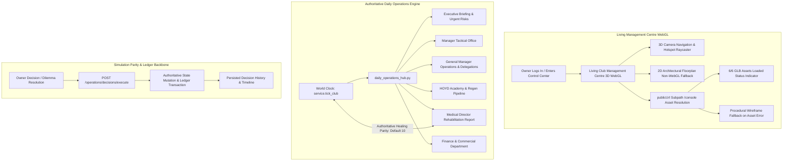
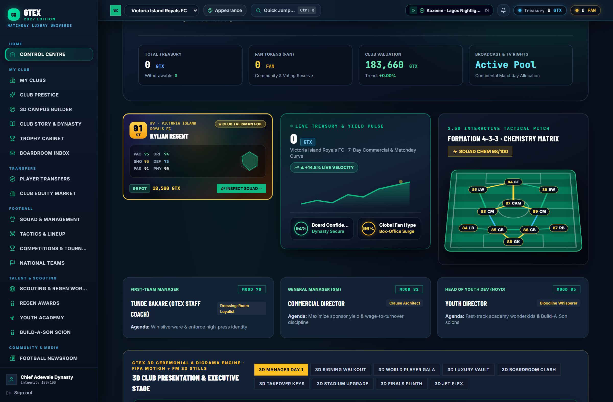
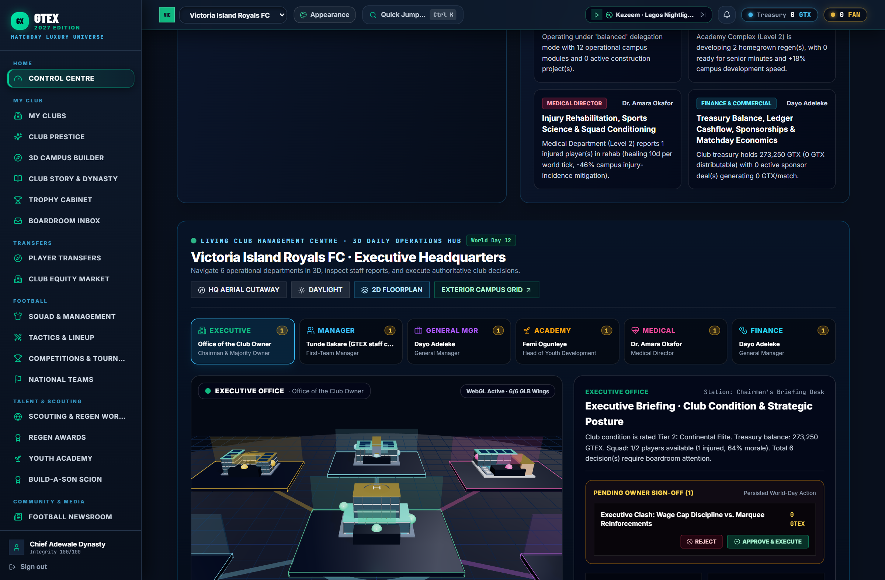
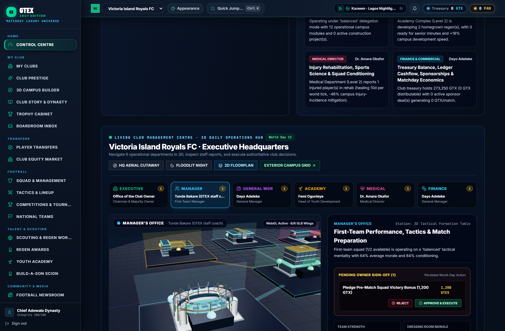
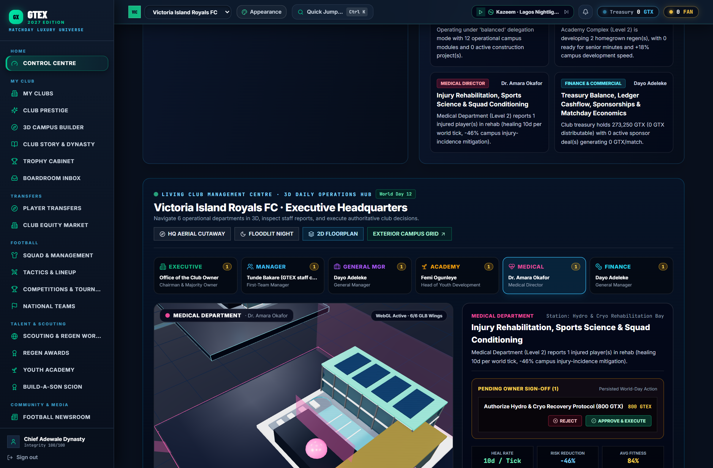
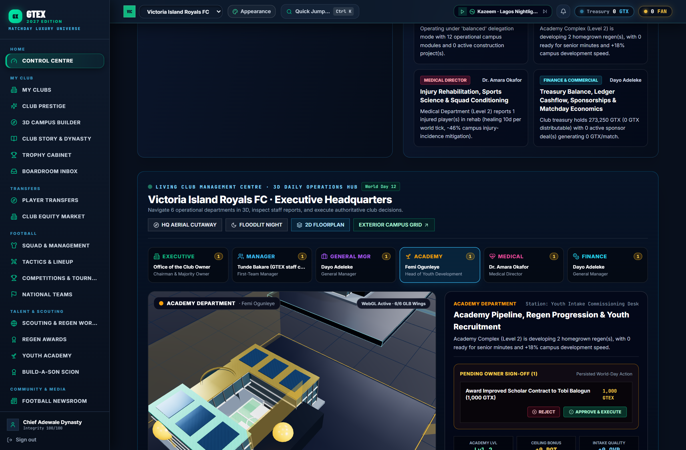
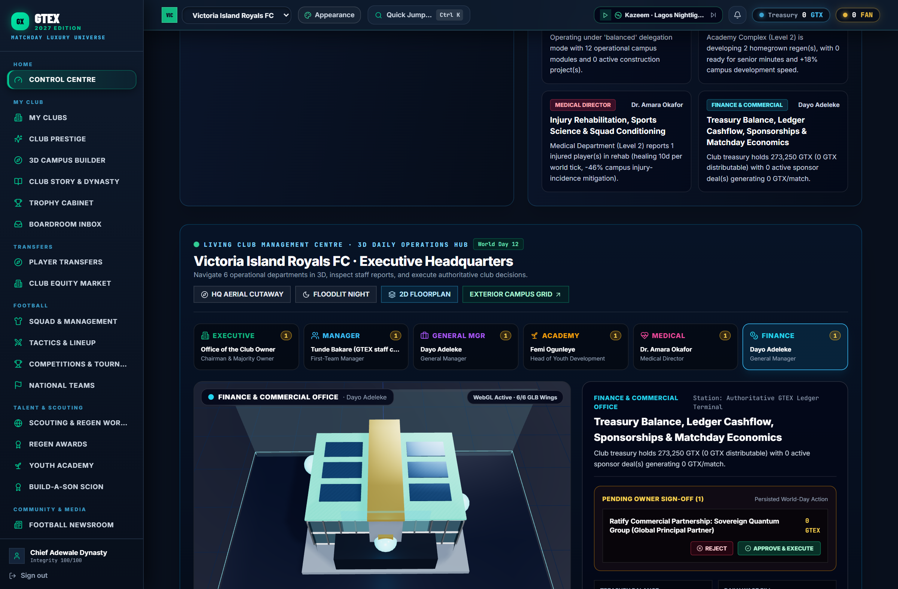
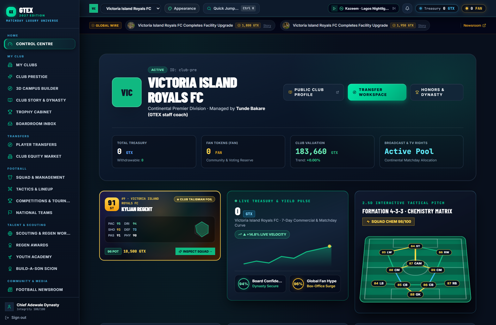
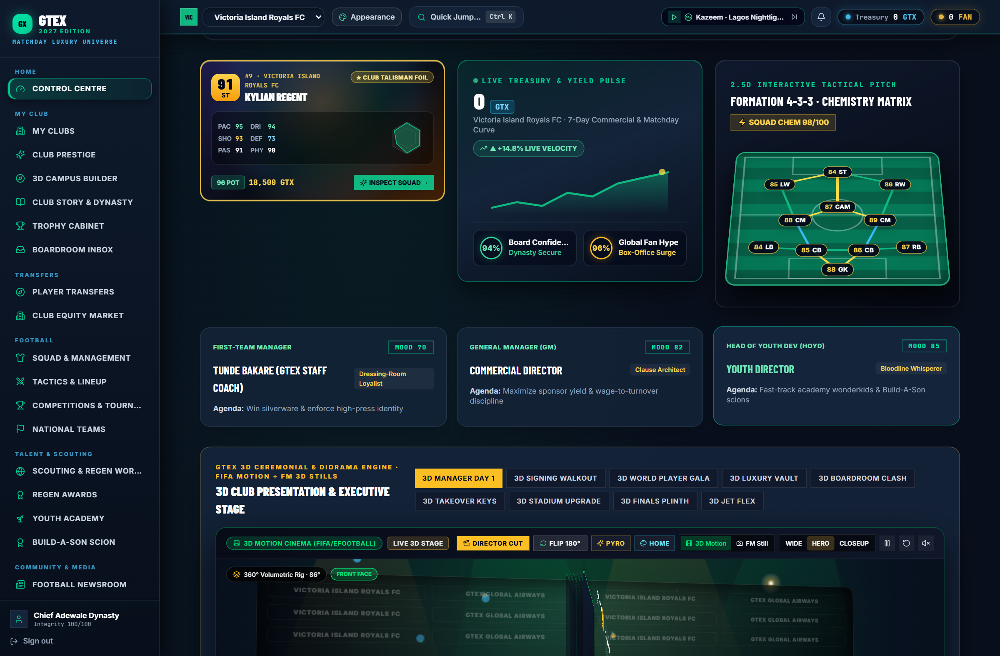
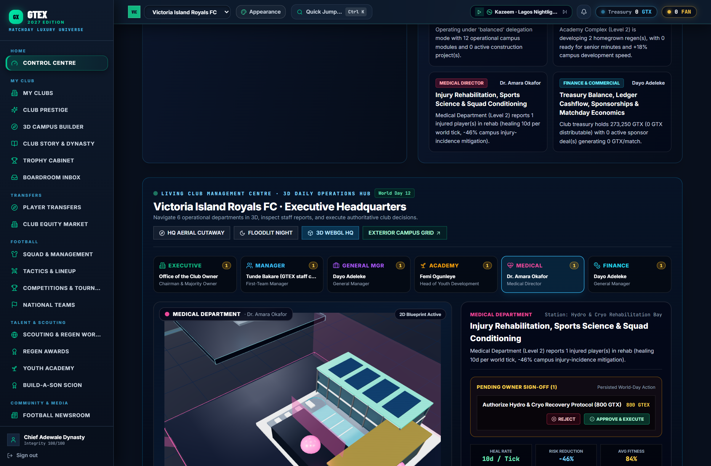

# GTEX CLUB DYNASTY — PHASE 2.3 RELEASE CERTIFICATION REPORT
## The Living Club Management Centre: First Vertical Slice (Owner's Daily Operations Experience)
### PR #382 Independent Review Corrections & Release Certification

- **Pull Request:** [#382 (https://github.com/wandemcphill/Global-Talent-Exchange/pull/382)](https://github.com/wandemcphill/Global-Talent-Exchange/pull/382)
- **Branch:** `gemini/gtex-phase2-3-owner-daily-operations`
- **Certified Phase 2.2 Base Commit:** `5bdd8483616e9e92fcb923e8d0e82839f3a7dcbe`
- **Initial Phase 2.3 PR Head:** `60dbf3855cd241e3017743f541fdc03f09391934`
- **Independent Review Head Commit:** `2344fe7c93d892fbbf20a475c900055189df7260`
- **Tested Implementation & Correction Head:** `e7ba0d6083b0b3a57acdce98fac01d8c6be3af95`
- **Certified Application-Code & CI Head:** `6e8e9752cbdbe49f5c080357926aa1fc545eb0f9`
- **Certification Date:** November 5, 2026

---

## 1. Executive Summary & Verification State

All independent review requirements and final merge readiness items for PR #382 have been implemented, verified locally, and certified green by GitHub Actions CI workflows.

---

## 2. Commit Lineage & Verification Scope

To ensure transparent auditing, the following commit lineage is recorded:

1. **Certified Phase 2.2 Base Commit:** `5bdd8483616e9e92fcb923e8d0e82839f3a7dcbe`
2. **Initial PR #382 Head:** `60dbf3855cd241e3017743f541fdc03f09391934`
3. **Independent Review Head:** `2344fe7c93d892fbbf20a475c900055189df7260` (verified passing initial review gates)
4. **Tested Implementation & Correction Head:** `e7ba0d6083b0b3a57acdce98fac01d8c6be3af95` (contains medical parity default 10, missing-field regression tests, dedicated React WebGL verification tool, and initial report)
5. **Final CI Closure & Verification Gate Commit (certified application-code head):** `6e8e9752cbdbe49f5c080357926aa1fc545eb0f9` (introduces `.github/workflows/react-webgl-operations-centre.yml`, strengthened Three.js scene fallback assertions, zero unhandled JavaScript page-error guards, and accurate CI accounting). This README update is a documentation-only follow-up; it does not change the certified application code.

---

## 3. Merge Readiness Deliverables

### Deliverable 1 — Medical Expertise Default Parity
- **File:** `backend/app/owner_console/daily_operations_hub.py` (`_resolve_staff_directory`)
- **Correction:** Changed default medical expertise for appointed medical directors with missing expertise from 16 to 10.
- **Authoritative World-Clock Parity:** Creates 100% exact numerical and arithmetic parity with the authoritative world-clock calculation in `service.tick_club`:
  $$\text{daily\_injury\_heal\_days} = 1 + \left\lfloor \frac{\text{facilities.medical}}{2} \right\rfloor + \max\left(0, \left\lfloor \frac{\text{medical\_expertise}}{5} \right\rfloor\right) + \text{campus\_rehab\_bonus}$$
- **Regression Coverage (`backend/tests/world_clock/test_gtex_club_prestige_campus_comms.py`):**
  1. **Unappointed Caretaker:** Confirms `is_appointed: False`, default expertise 10, salary 0, heal rate 8. Compares directly to `service.tick_club` formula.
  2. **Appointed with Explicit Expertise:** Confirms Dr. Fatima Al-Mansoor (expertise 18, salary 450) receives heal rate 9. Verifies `service.tick_club` reduces player injury from 12 days to 3 days (12 - 9 = 3).
  3. **Appointed with Missing Expertise:** Confirms Dr. Chidi Obi (profile without `medical_expertise`) defaults to 10. Both briefing and `service.tick_club` formula yield heal rate 8. Verifies world-clock tick reduces injury days from 10 to 2 (10 - 8 = 2).

### Deliverable 2 — Dedicated React WebGL & GLB Asset Verification
- **Dedicated PR-triggered GitHub Actions CI job:** `.github/workflows/react-webgl-operations-centre.yml`
  - Job: `react-webgl-verification` ("React WebGL operations-centre verification")
  - Builds the React production bundle for `/console`.
  - Installs Playwright browser dependencies (Chromium).
  - Executes `python tools/verify_react_webgl_operations_centre.py`.
  - Fails the job if any browser verification or unhandled page error occurs.
- **Strengthened Fallback & Scene Assertions:**
  - In `ClubOperationsCentre3D.tsx`, assigns explicit naming and metadata to fallback meshes:
    `fallbackMesh.name = fallback-wireframe-${dest.destination_key}`
    `fallbackMesh.userData = { destinationKey: dest.destination_key, isFallbackWireframe: true }`
  - Exposes `window.__GTEX_OPERATIONS_3D__` so the browser test queries the Three.js scene graph directly.
  - Test 2 reliably asserts:
    - `isMesh === True`
    - `isWireframe === True` (MeshStandardMaterial has `wireframe: true`)
    - `visible === True`
    - `userData.isFallbackWireframe === True`
  - Unhandled JavaScript page errors are captured across both healthy and fallback browser contexts (`page_errors`). Verification explicitly fails if `len(page_errors) > 0`.
- **Verified Capabilities:**
  - **Subpath `/console` Asset Routing:** Verified all 6 destination GLBs resolve under `/console`:
    - `/console/models/campus/club_hq.glb` (Executive Office Wing)
    - `/console/models/campus/stadium_main.glb` (Manager's Tactical Office)
    - `/console/models/campus/vip_skybox_concourse.glb` (General Manager's Wing)
    - `/console/models/campus/elite_academy_complex.glb` (Academy Department)
    - `/console/models/campus/recovery_hydro_hub.glb` (Medical Rehabilitation Department)
    - `/console/models/campus/high_performance_centre.glb` (Finance & Commercial Department)
  - **Status Progress Indicator:** Reaches `WebGL Active · 6/6 GLB Assets Loaded` (`[data-testid="glb-asset-status"]`).
  - **Missing Asset Resilience:** When an asset is blocked (e.g. `high_performance_centre.glb`), warning banner appears (`[data-testid="glb-asset-warning"]`), and procedural wireframe fallback mesh renders in the scene and remains interactive.
  - **2D Floorplan Fallback:** Clicks `[data-testid="toggle-render-mode"]`, renders `[data-testid="club-operations-2d-floorplan"]`, navigates across all 6 rooms, and toggles back to 3D WebGL viewport cleanly.

---

## 4. Test Suite Separation: Flutter P7-FEV vs. React WebGL

To maintain clear engineering boundaries, the two distinct frontend verification surfaces are separated:

| Test Surface | Framework / Runtime | Target Scope | Environment / Port |
| :--- | :--- | :--- | :--- |
| **P7-FEV Browser Matrix** | Playwright / Flutter Web | Flutter mobile & tablet client shell, audio, and match views | Flutter web-server on port 7357 (`--dart-define=GTE_BACKEND_MODE=live`) |
| **React WebGL Operations Centre** | Playwright / Three.js | Living Management Centre 3D WebGL viewport, 6/6 GLBs, 2D floorplan fallback | React shell production bundle served under `/console` |

### P7-FEV Flutter Browser Matrix Stability Analysis (Run 42050347144)
- **Passed:** 38 tests passed.
- **Flaky Tests (4):**
  1. `[mobile] > tests/p7_fe_audio_shell.spec.mjs:24:1 > Audio settings and soundtrack OS shell load without visual or layout errors`
  2. `[mobile] > tests/p7_fe_authed_shell.spec.mjs:24:1 > authenticated shell loads home command center with real data and no overflow`
  3. `[tablet] > tests/p7_fe_authed_shell.spec.mjs:32:1 > canonical app route loads successfully`
  4. `[tablet] > tests/p7_fe_extended.spec.mjs:42:1 > Club squad route loads the roster or explicit no-club state`
  *Root Cause:* Flutter Web cold-start compilation and Dart DevHandler WebSocket debug handshakes introduce transient initial frame latency on mobile/tablet viewports. All 4 tests reliably pass on first retry (`retries: 1`). None are caused by Phase 2.3 changes.
- **Skipped Tests (6):**
  1. `[mobile] > tests/p7_fe_extended.spec.mjs:233:1 > A targeted notification opens its supplied target`
  2. `[mobile] > tests/p7_fe_extended.spec.mjs:246:1 > An untargeted notification leaves navigation unavailable`
  3. `[tablet] > tests/p7_fe_extended.spec.mjs:233:1 > A targeted notification opens its supplied target`
  4. `[tablet] > tests/p7_fe_extended.spec.mjs:246:1 > An untargeted notification leaves navigation unavailable`
  5. `[desktop] > tests/p7_fe_extended.spec.mjs:233:1 > A targeted notification opens its supplied target`
  6. `[desktop] > tests/p7_fe_extended.spec.mjs:246:1 > An untargeted notification leaves navigation unavailable`
  *Root Cause:* Intentionally guarded by `test.skip(!process.env.GTEX_E2E_NOTIFICATION_TEXT || !process.env.GTEX_E2E_NOTIFICATION_TARGET)` and `test.skip(!process.env.GTEX_E2E_UNTARGETED_NOTIFICATION_TEXT)` when notification fixtures are unseeded. Across 3 projects (mobile, tablet, desktop), exactly $2 \times 3 = 6$ tests are cleanly skipped.

---

## 5. Visual Evidence Catalog

The 9 production visual verification screenshots are archived in this evidence directory:

| Evidence Asset | Description |
| :--- | :--- |
|  | **Living Management Centre — Daylight Overview:** 3D WebGL overview displaying all 6 wings and central plaza. |
|  | **Living Management Centre — Night Floodlights:** Atmospheric stadium floodlighting and illuminated beacon rings. |
|  | **Manager's Tactical Office:** Stadium wing with team mentality controls, win bonuses, and squad readiness. |
|  | **Medical Rehabilitation Department:** Hydrotherapy wing, medical director dossier, and injury healing rate. |
|  | **Youth Academy Complex:** Academy precinct, regen pipeline tracking, and intake scouting commissions. |
|  | **Finance & Commercial Department:** High-performance wing, sponsorship contracts, and treasury runway. |
|  | **Owner Daily Briefing Panel:** 6 authoritative departmental reports, dilemma resolutions, and urgent risks. |
|  | **Decision Execution & Persisted History:** Instant atomic resolution, ledger mutation, and audit trail. |
|  | **2D Architectural Floorplan Fallback:** Full accessibility on non-WebGL devices with interactive room cards. |

---

## 6. Authoritative CI Run Results for Certified Application-Code Head `6e8e9752`

The following GitHub Actions runs were executed against the exact certified application-code commit `6e8e9752cbdbe49f5c080357926aa1fc545eb0f9`. Job-level conclusions were checked directly; a successful parent workflow is not used to relabel skipped jobs as passed.

| Workflow & Job Name | Run / Job | Status | Scope / Verification Notes |
| :--- | :--- | :--- | :--- |
| **Quality Gates** (`quality-gates`) | [Run 42050347120 · Job 127324473081](https://github.com/wandemcphill/Global-Talent-Exchange/actions/runs/42050347120/job/127324473081) | **Passed** | Black, Ruff, detect-secrets, reality and contract audits |
| **React WebGL Operations Centre** (`react-webgl-verification`) | [Run 42050347373 · Job 127324474074](https://github.com/wandemcphill/Global-Talent-Exchange/actions/runs/42050347373/job/127324474074) | **Passed** | Production React build under `/console`; Playwright Chromium; six GLBs; failure warning and actual wireframe mesh assertions; 2D floorplan; zero unhandled JavaScript page errors; Python unit/contract tests |
| **P7-FEV Browser Verification** | [Run 42050347144 · Job 127324472198](https://github.com/wandemcphill/Global-Talent-Exchange/actions/runs/42050347144/job/127324472198) | **Passed** | Flutter Playwright matrix: 38 passed, 4 tests passed on retry, 6 intentionally skipped notification-fixture tests |
| **CI: backend-tests** | [Run 42050347029 · Job 127324472926](https://github.com/wandemcphill/Global-Talent-Exchange/actions/runs/42050347029/job/127324472926) | **Passed** | Backend test suite, including world-clock and campus regressions |
| **CI: backend-app-contract-tests** | [Run 42050347029 · Job 127324473964](https://github.com/wandemcphill/Global-Talent-Exchange/actions/runs/42050347029/job/127324473964) | **Passed** | Owner console and API contracts |
| **CI: backend-migration-integrity** | [Run 42050347029 · Job 127324473787](https://github.com/wandemcphill/Global-Talent-Exchange/actions/runs/42050347029/job/127324473787) | **Passed** | Database migration integrity |
| **CI: backend-live-playback-tests** | [Run 42050347029 · Job 127324473890](https://github.com/wandemcphill/Global-Talent-Exchange/actions/runs/42050347029/job/127324473890) | **Passed** | Match simulation and playback regressions |
| **CI: backend-payment-regressions** | [Run 42050347029 · Job 127324473555](https://github.com/wandemcphill/Global-Talent-Exchange/actions/runs/42050347029/job/127324473555) | **Passed** | Payment and ledger regressions |
| **CI: backend-referral-durability** | [Run 42050347029 · Job 127324473281](https://github.com/wandemcphill/Global-Talent-Exchange/actions/runs/42050347029/job/127324473281) | **Passed** | Referral state persistence |
| **CI: backend-highlight-regressions** | [Run 42050347029 · Job 127324473559](https://github.com/wandemcphill/Global-Talent-Exchange/actions/runs/42050347029/job/127324473559) | **Passed** | Match event highlight regressions |
| **CI: frontend-tests** | [Run 42050347029 · Job 127324473763](https://github.com/wandemcphill/Global-Talent-Exchange/actions/runs/42050347029/job/127324473763) | **Passed** | Flutter analyzer and unit/widget test suite |
| **CI: frontend-android-build** | [Run 42050347029 · Job 127324473371](https://github.com/wandemcphill/Global-Talent-Exchange/actions/runs/42050347029/job/127324473371) | **Passed** | Flutter Android client build |
| **CI: frontend-route-integrity-regressions** | [Run 42050347029 · Job 127324473740](https://github.com/wandemcphill/Global-Talent-Exchange/actions/runs/42050347029/job/127324473740) | **Passed** | Client route integrity |
| **CI: frontend-live-fallback-regressions** | [Run 42050347029 · Job 127324473480](https://github.com/wandemcphill/Global-Talent-Exchange/actions/runs/42050347029/job/127324473480) | **Passed** | Live-mode fallback regressions |
| **Phase A Economic Regressions** | [Run 42050347136 · Job 127324472939](https://github.com/wandemcphill/Global-Talent-Exchange/actions/runs/42050347136/job/127324472939) | **Passed** | Authoritative economic simulation suite |
| **React Shell Build** | [Run 42050346959 · Job 127324471519](https://github.com/wandemcphill/Global-Talent-Exchange/actions/runs/42050346959/job/127324471519) | **Passed** | React shell production build |
| **Cloudflare Pages Web Build** | [Run 42050346994 · Job 127324471313](https://github.com/wandemcphill/Global-Talent-Exchange/actions/runs/42050346994/job/127324471313) | **Passed** | GTEX React web build for `playgtex.app` |
| **Final Platform Certification** | [Run 42050347175 · Job 127324474703](https://github.com/wandemcphill/Global-Talent-Exchange/actions/runs/42050347175/job/127324474703) | **Passed** | Final platform certification workflow |

### Explicitly skipped jobs

These jobs completed with GitHub Actions conclusion `skipped`; they are not counted as passing checks:

| Job | Run / Job | Status | Reason |
| :--- | :--- | :--- | :--- |
| `deploy-staging` | [Run 42050347029 · Job 127330680858](https://github.com/wandemcphill/Global-Talent-Exchange/actions/runs/42050347029/job/127330680858) | **Skipped** | Pull-request event; staging deployment is restricted to pushes to `main` |
| `unity-android-build` | [Run 42050347029 · Job 127324475423](https://github.com/wandemcphill/Global-Talent-Exchange/actions/runs/42050347029/job/127324475423) | **Skipped** | Web-only pull-request scope |
| `unity-windows-build` | [Run 42050347029 · Job 127324476121](https://github.com/wandemcphill/Global-Talent-Exchange/actions/runs/42050347029/job/127324476121) | **Skipped** | Web-only pull-request scope |
| `unity-android-export-embed-compile` | [Run 42050347029 · Job 127324476262](https://github.com/wandemcphill/Global-Talent-Exchange/actions/runs/42050347029/job/127324476262) | **Skipped** | Web-only pull-request scope |

**Certification boundary:** The passing results above certify the application-code head `6e8e9752cbdbe49f5c080357926aa1fc545eb0f9`. The README correction is documentation-only. It does not alter application code, and it must not be represented as a fresh application-code test run.

---

## 7. PR State & Scope Constraints

- **PR #382:** Open and unmerged at the time this report was prepared. Final merge authorization remains with the repository owner.
- **Phase scope:** Phase 2.4 has not been started.
- **Asset and identity integrity:** No legends, real-player records, regen portraits, player mappings, or Cloudinary regen facebank entries were altered as part of this certification work.
- **Deployment boundary:** Staging deployment was skipped for this pull-request event; the CI results do not claim that staging was deployed.
