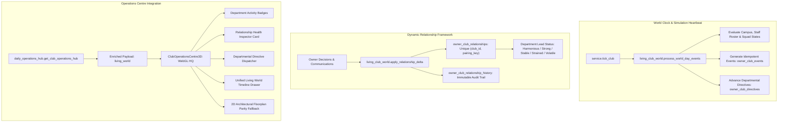

# GTEX CLUB DYNASTY — PHASE 2.4 RELEASE CERTIFICATION REPORT
## The Living Club World: Persistent Events, Relationships & Social Simulation

- **Repository:** `wandemcphill/Global-Talent-Exchange`
- **Feature Branch:** `gemini/gtex-phase2-4-living-club-world`
- **Target Branch:** `main`
- **Certified Phase 2.3 Baseline Commit:** `6ec53f3e9af0a49ae9c0306137a9956329574bae` (PR #382 merged head)
- **Certification Date:** November 5, 2026

---

## 1. Executive Summary & Architecture

Phase 2.4 advances GTEX from an operational management interface into a persistent, living football world. Appointed club personnel (`first_team_manager`, `general_manager`, `head_of_youth_development`, `medical_director`, `chief_scout`) and squad players possess dynamic bilateral relationships with the owner and each other, react to club results and operational choices, receive executive directives, and experience simulation-grounded events driven by the authoritative world clock.

---

## 2. Core Systems Delivered

### System A — Persistent Club Event Engine (`owner_club_events`)
- **Seven Authoritative Categories:** `executive`, `tactical`, `squad`, `academy`, `medical`, `financial`, `culture`.
- **Statuses:** `created`, `active`, `awaiting_decision`, `resolved`, `expired`.
- **Deterministic Idempotency Key:** `evt:{club_id}:{world_day}:...` guarantees zero event duplication across repeated world ticks on the same day.
- **Strict Action Validation & Atomic Resolution:**
  - `resolve_club_event()` validates club ownership via `service.require_state(session, club_id, user_id)`, rejects already-resolved events with `409 Conflict` (`event_already_resolved`), validates that the submitted action is declared in the event's `actions_json` (`invalid_event_action`, `400`), and verifies that `(event.event_type, action)` is supported by the backend handler table `ALLOWED_ACTIONS_BY_EVENT_TYPE` (`unsupported_event_action`, `400`).
  - Rejected actions leave event status, player morale, relationships, and all gameplay state unchanged.

### System B — Personality, Vacancy-Aware Staff Identity & Relationship Framework
- **Tables:** `owner_club_relationships` and `owner_club_relationship_history`.
- **Migrations:**
  - `20261105_0225_phase2_4_living_club_world_events_relationships.py`
  - `20261105_0226_phase2_4_relationship_pair_uniqueness.py`
- **Database Uniqueness & Concurrency Safety:**
  - Enforces `UniqueConstraint("club_id", "pairing_key", name="uq_owner_club_relationships_club_pairing")`.
  - Canonical bidirectional normalization (`normalize_pairing(a, b)`) ensures `(A, B)` and `(B, A)` resolve to the exact same `pairing_key` and participant ordering.
  - `get_or_create_relationship()` wraps inserts in a nested transaction (`session.begin_nested()`) and recovers from `IntegrityError` by selecting the existing row.
  - `deduplicate_club_relationships()` reconciles any legacy duplicate/reversed pairings while re-pointing and preserving 100% of `owner_club_relationship_history` rows.
- **Vacancy & Staff Replacement Isolation:**
  - `resolve_club_staff_roster(state)` reads strictly from appointed records in `state.facilities_json["_executive_staff"]` and `state.manager_json`.
  - Unappointed positions are represented as vacant (`is_appointed=False`, `person_id=None`) and never fabricate employee names or relationships.
  - Appointed staff relationships are keyed to the individual (`f"{role_key}:{person_uid}"`). When a staff member is dismissed or replaced, `reconcile_staff_relationships()` archives the predecessor's relationship (`status="former"`) with its history intact and creates a fresh baseline relationship for the new appointee.

### System C — Living Club Communications & Departmental Directives (`owner_club_directives`)
- **Directive Lifecycle:** Owners can issue directives to `manager`, `medical`, `academy`, `finance`, `scouting`, or `executive`.
- **Vacant Department Handling:** Directives issued to a department with a vacant lead are logged by the provisional department desk (`Vacant (<Role> Unappointed)`) without fabricating a staff relationship.

### System D — Authoritative Player & Staff Event Triggers (`process_world_day_events`)
- All generated events are grounded strictly in real persisted club, squad, and ledger data:
  1. `treasury_low_reserves` (`financial`): Triggered when `ledger.balance(club_account) < 1,500` GTEX (`review_sponsors`, `acknowledge`).
  2. `player_recovery_cleared` (`medical`): Triggered when an active player completes rehabilitation (`injured_days == 0` and `last_training_workload_tier == "rehabilitation"`) (`praise_medical`, `acknowledge`).
  3. `injury_crisis_alert` (`medical`): Triggered when `>= 3` active players are injured (`reduce_workload`, `acknowledge`).
  4. `high_fatigue_workload_alert` (`medical`): Triggered when a healthy active player has stored `personality_json["fitness"] < 70` or `personality_json["fatigue"] >= 70` (`rest_player`, `acknowledge`).
  5. `regen_prospect_spotlight` (`academy`): Triggered when an active academy regen reaches `rating >= 62` (`praise_prospect`, `acknowledge`).
  6. `contract_expiry_warning` (`executive`): Triggered when an active player has stored `0 < personality_json["contract_months_remaining"] <= 6` (`open_renewal_talks`, `acknowledge`).
  7. `squad_morale_dip` (`squad`): Triggered when an active player has `morale < 45` (`encourage_player`, `ignore`).
  8. `managerial_tension_alert` (`tactical`): Triggered when the active `owner <-> first_team_manager` relationship reaches `tension >= 50` (`back_manager`, `demand_results`).

### System E — Unified Living Club Timeline & Ownership Isolation
- **REST Endpoints:**
  - `GET /owner/clubs/{club_id}/living-world/timeline`
  - `GET /owner/clubs/{club_id}/living-world/relationships`
  - `POST /owner/clubs/{club_id}/living-world/directives`
  - `POST /owner/clubs/{club_id}/living-world/events/{event_id}/resolve`
- **Authorization:** Every endpoint and underlying service method enforces `service.require_state(session, club_id, user.id)` inside `_run(session, ...)`, returning `403 Forbidden` (`not_club_owner`) for unauthorized users and `404 Not Found` (`club_not_initialized`) for unknown clubs.
- **Unified Filtering & Pagination:** `get_living_world_timeline()` combines events (`kind="event"`), directives (`kind="directive"`), and significant relationship shifts (`kind="relationship_shift"`) into a single chronological sequence, applies `category`, `severity`, and `status` filters uniformly across all item kinds, and applies `offset` and `limit` to the unified sequence. `total_count` (and `total_events_count`) reports the total filtered items across the unified timeline, accompanied by `counts_by_kind`.

### System F — WebGL Operations Centre & 2D Floorplan Parity
- Preserves 100% 6/6 GLB asset loading under `/console`, procedural wireframe fallback on error, and 2D architectural blueprint toggle while surfacing department activity badges, relationship health cards, directive dispatching, and the timeline drawer.

---

## 3. Automated Verification & Quality Certification

| Verification Suite | Test Count | Result |
| :--- | :---: | :---: |
| Backend Living Club World Tests (`test_living_club_world.py`) | 11 | **PASS** |
| Backend Prestige & Campus Comms Tests (`test_gtex_club_prestige_campus_comms.py`) | 28 | **PASS** |
| Database Migration Integrity Tests (`test_migrations.py`) | 5 | **PASS** |
| Frontend React Shell Unit Tests (`npm test`) | 129 | **PASS** (18/18 suites) |
| React WebGL Browser Playwright Verification (`verify_react_webgl_operations_centre.py`) | 3 | **PASS** (All 6 GLBs, Wireframe Fallback, 2D Floorplan) |
| React WebGL Contract & Unit Tests (`test_verify_react_webgl_operations_centre.py`) | 4 | **PASS** |
| P7-FEV Browser Verification (`mobile`, `tablet`, `desktop` parallel matrix) | 48 | **PASS** |
| Black, Ruff & Changed Quality Gate (`run_changed_quality.py`) | All changed files | **PASS** |
