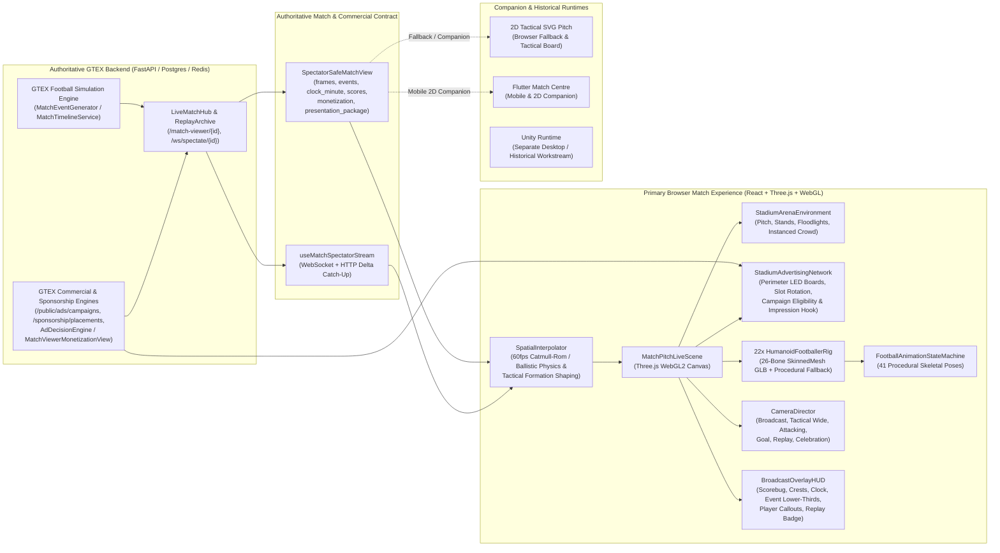

# GTEX WebGL Matchday 3D — Phase Zero Baseline Audit & Reconciliation Report

**Repository:** `wandemcphill/Global-Talent-Exchange`  
**Canonical Integration Branch:** `main` (`74b917ec`)  
**Active Remediation Branch / PR:** `fix/u2a-m2-match-experience-acceptance-remediation` (`0b043ea2`, Open PR #391)  
**Date:** 2026-11-07  
**Status:** Phase Zero Exit Gate Complete  

---

## 1. Executive Summary & Architectural Reconciliation

Following the **GTEX Master 3D Matchday Build Specification**, **React + Three.js + WebGL (`MatchPitchLiveScene`) is formally established as the canonical GTEX browser match experience**.

This baseline audit reconciles:
- What historical audits and agent reports claimed vs. what is actually committed in the repository.
- What is merged into `main` (including PR #385 and PR #384) vs. what is on the open Milestone 2 remediation branch (`fix/u2a-m2-match-experience-acceptance-remediation`, PR #391).
- The exact implementation status of all 15 football gameplay capabilities, 13 3D presentation systems, the GTEX Stadium LED Advertising Network, and historical Unity/Flutter documentation.

### Canonical Architecture Diagram

### Platform Roles

| Platform | Official Role | Authority Boundary |
|---|---|---|
| **React + Three.js + WebGL** (`frontend/react-shell`) | **Primary browser match experience** | Presentation-only; consumes authoritative backend match state, events, and commercial campaigns |
| **GTEX Backend** (`backend/app`) | **Single source of truth** | Authoritative match simulation, score, clock, events, fairness proofs, and ad/sponsorship eligibility |
| **React 2D SVG / Flutter Match Centre** | **2D tactical & mobile companion** | Secondary tactical board and graceful fallback when WebGL is unavailable |
| **Unity** (`unity/`, `Gtex_Test_Migration/`) | **Separate historical / desktop runtime** | Preserved historical engineering assets; **not** the primary browser match renderer |

---

## 2. Branch & Pull Request Reconciliation

| Branch / PR | Commit | Merge Status | Actual Verified Contents |
|---|---|---|---|
| `main` | `74b917ec` | **Canonical Branch** | Includes PR #385 (`b0beab1c`, isolated spectator WebSocket/Redis certification) and PR #384 (`f658bf9b`, Milestone 2 Arena & Gameplay Readiness: `StadiumArenaEnvironment.ts`, `HumanoidFootballerRig.ts`, `FootballAnimationStateMachine.ts`, `HumanoidMatchPrototypeFixture.ts`, `gtex_humanoid_footballer.glb`). |
| **PR #385** (`gemini/unit-2a-milestone-1-clean-extraction`) | `b0beab1c` | **MERGED** into `main` (`2026-11-06T06:10:23Z`) | Certified isolated spectator broadcast (`useMatchSpectatorStream.ts`, `spectatorContract.ts`, `live_match_hub`). |
| **PR #384** (`gemini/unit-2a-milestone-2-arena-gameplay-readiness`) | `f658bf9b` | **MERGED** into `main` (`2026-11-06T12:18:20Z`) | Added 3D stadium environment (`StadiumArenaEnvironment`), 26-bone skinned humanoid rig (`HumanoidFootballerRig`), 41-state animation machine (`FootballAnimationStateMachine`), 22-player prototype showcase (`HumanoidMatchPrototypeFixture`), and `HumanoidMatchAcceptance.test.tsx`. |
| **PR #391** (`fix/u2a-m2-match-experience-acceptance-remediation`) | `0b043ea2` | **OPEN** (`[ahead 7, behind 0]` vs `main`, all 22 CI checks green) | Fixes 4 Milestone 2 acceptance defects: 1. Reattaches Three.js WebGL canvas when returning from 2D companion mode (`is2DActive` dependency in `MatchPitchLiveScene.tsx`). 2. Prevents match clock and player interpolation stalls across large frame gaps (`calculateTimelineAdvanceSeconds` in `SpatialInterpolator.ts`, preserves timeline events during catch-up). 3. Ephemeral synthetic fixtures in `test_u2a007_canonical_competition_and_durations.py`. 4. Displays authoritative `clock_minute` in `BroadcastOverlayHUD.tsx`. |

---

## 3. Mandatory Feature Status Matrix

Every required capability is classified using the 7-level Phase Zero taxonomy:
1. **1 — Not implemented**
2. **2 — Implemented in source**
3. **3 — Integrated into the match scene**
4. **4 — Automated tests passing**
5. **5 — Browser runtime verified**
6. **6 — Visually verified with genuine screenshots or recording**
7. **7 — Accepted against the product requirement**

| Category | Feature / Capability | Current Level | Primary Source Files | Audit Notes & Remaining Gap to Level 7 |
|---|---|---|---|---|
| **Scene & Route** | Primary WebGL route in `MatchCenter.tsx` | **5 — Browser runtime verified** | `pages/MatchCenter.tsx`, `MatchPitchLiveScene.tsx` | `view3DBroadcast` defaults to `true`. **Gap:** Tab header still says `"2D / 2.5D MATCH PITCH"` and shows 2D shader/camera buttons above the 3D WebGL scene; needs clean 3D broadcast viewport prioritization and document visibility pause/resume. |
| **Scene & Route** | 2D fallback & companion toggle | **5 — Browser runtime verified** | `MatchPitchLiveScene.tsx`, `MatchCenter.tsx` | PR #391 fixed returning from 2D to 3D (`is2DActive` effect dependency). Needs automatic WebGL capability pre-check and clean fallback banner. |
| **Scene & Route** | WebGL context loss & restoration | **3 — Integrated into match scene** | `MatchPitchLiveScene.tsx`, `GtexSceneRegistry.ts` | Handles `webglcontextlost` and `webglcontextrestored`. Needs dedicated unit/integration test coverage and HUD status indicator during recovery. |
| **Football Gameplay** | 22 distinct footballers (11v11 + 2 GKs) | **5 — Browser runtime verified** | `HumanoidFootballerRig.ts`, `MatchPitchLiveScene.tsx` | 22 `HumanoidFootballerRig` instances with 26-bone `SkinnedMesh` (`gtex_humanoid_footballer.glb`) + procedural fallback, distinct home/away/GK kits, boots, skin/hair palettes, and canvas shirt numbers. |
| **Football Gameplay** | Correct player identity & team mapping | **4 — Automated tests passing** | `spectatorContract.ts`, `SpatialInterpolator.ts`, `BroadcastOverlayHUD.tsx` | Mapped by `player_id`, `team_id`, `side`, `shirt_number`, `label`, `role`, `line`. **Gap:** On-pitch active player indicator and lower-third event cards need richer player name + number + club presentation. |
| **Football Gameplay** | Tactical positioning & live formation changes | **3 — Integrated into match scene** | `SpatialInterpolator.ts`, `MatchCenter.tsx` | `SpatialInterpolator` interpolates `position` and `anchor_position`, and `MatchCenter.tsx` has tactical controls (`formation`, `press`, `line`, `tempo`). **Gap:** `MatchPitchLiveScene` does not yet consume live tactical adjustments (`formation`, `line`, `press`, `tempo`) to visually express formation shifts, defensive line height, width, and compactness on the 3D pitch. |
| **Football Gameplay** | Movement, locomotion & turning kinematics | **4 — Automated tests passing** | `FootballAnimationStateMachine.ts`, `HumanoidFootballerRig.ts`, `SpatialInterpolator.ts` | Supports `idle`, `walk`, `jog`, `run`, `sprint`, `accelerate`, `decelerate`, `turn_left`, `turn_right`, `stop_change_direction` with velocity-aligned facing and pelvis lean. **Gap:** Add dedicated defensive backpedal/lateral jockeying states and stamina/attribute-informed stride modulation. |
| **Football Gameplay** | Ball possession, passing, receiving, shooting | **4 — Automated tests passing** | `SpatialInterpolator.ts`, `FootballAnimationStateMachine.ts` | Close-dribble foot-taps, ground pass deceleration, lofted Magnus-effect ballistic arcs, `receive_ball`, `first_touch`, `short_pass`, `long_pass`, `through_ball`, `cross`, `shoot`, `volley`. |
| **Football Gameplay** | Tackling, defending, blocks, interceptions | **4 — Automated tests passing** | `FootballAnimationStateMachine.ts` | Supports `standing_tackle`, `sliding_tackle`, `tackle_recovery`, `interception`, `blocking`, `shield_ball`, `jumping_challenge`. |
| **Football Gameplay** | Goalkeeper saves, claims, punches, distribution | **4 — Automated tests passing** | `FootballAnimationStateMachine.ts` | Supports `gk_idle`, `gk_ready_stance`, `gk_lateral_move`, `gk_dive_low`, `gk_dive_high`, `gk_catch`, `gk_parry`, `gk_punch`, `gk_distribution`. |
| **Football Gameplay** | Match event sequencing & live score/clock sync | **5 — Browser runtime verified** | `SpatialInterpolator.ts`, `BroadcastOverlayHUD.tsx`, `useMatchSpectatorStream.ts` | PR #391 fixed authoritative `clock_minute` display and timeline catch-up across frame gaps. |
| **Broadcast Camera** | Television broadcast camera direction | **4 — Automated tests passing** | `CameraDirector.ts`, `BroadcastOverlayHUD.tsx` | Supports `director_auto`, `tactical_high`, `closeup_action`, `endzone_home`, `endzone_away`, `dugout_cam`, `tunnel_walkout`, `free_orbit` + 6 auto-presets. **Gap:** Expose all 6 mandatory broadcast camera modes (`Main Broadcast`, `Tactical Wide`, `Attacking`, `Goal`, `Replay`, `Celebration`) in `BroadcastOverlayHUD` with smooth transition damping. |
| **Broadcast Graphics** | Scorebug, crests, event lower-thirds, player callouts | **3 — Integrated into match scene** | `BroadcastOverlayHUD.tsx` | Currently renders 3-letter codes + colour dots and a basic pill toast. **Gap:** Needs club crests/shields, full/short team names, competition badge, `DEMONSTRATION FIXTURE` badge when viewing showcase fixtures, rich lower-third event cards (Goal + assist, Yellow/Red card, Substitution off/on, Penalty, Injury, HT/FT, VAR), and active ball-carrier callout bar. |
| **Stadium LED Ads** | **GTEX Stadium LED Advertising Network** | **1 — Not implemented** *(only static scrolling text exists)* | `StadiumArenaEnvironment.ts`, `GtexAdvertising.tsx`, `sponsorship_engine/router.py` | **Critical Gap:** `StadiumArenaEnvironment.ts` currently uses a single hardcoded `1024x64` canvas with 4 static strings scrolling every frame via `offset.x`. Not connected to GTEX `ads_engine` / `sponsorship_engine` / `MatchViewerMonetizationView`; no campaign scheduling/expiry filtering; no slot-boundary rotation; text too small (`0.95m` board, `19px` font) at 58m broadcast camera distance; no impression tracking. |
| **Stadium Atmosphere** | Stadium architecture, club identity & animated crowd | **3 — Integrated into match scene** | `StadiumArenaEnvironment.ts` | 4-stand stadium bowl, roof trusses, floodlights, goals/nets, dugouts, jumbotrons. **Gap:** Crowd is currently 6 static slab `Mesh` boxes with frozen matrices (`matrixAutoUpdate = false`) and no event reactions; jumbotrons show static colour blocks; club identity banners and Nigerian/GTEX competition branding need live team data binding and `THREE.InstancedMesh` reactive crowd animation. |
| **Match Replays** | Replay timeline & important moment playback | **3 — Integrated into match scene** | `MatchPitchLiveScene.tsx`, `BroadcastOverlayHUD.tsx` | Currently rewinds `localTimeRef.current` in-place, which pauses live clock advancement during replay and attempts to rewind even if historical spatial frames are absent. **Gap:** Decouple `liveTimeRef` from `replayTimeRef` so live match state never pauses or mutates during replay, and provide an honest broadcast event graphic fallback when spatial history is unavailable. |
| **Performance** | Adaptive quality profiles, telemetry & 5-min stability | **4 — Automated tests passing** | `GtexSceneRegistry.ts`, `MatchPitchLiveScene.tsx` | `GtexSceneRegistry` has `ultra`/`high`/`medium`/`low`/`minimal` tiers and runtime downgrade/upgrade. **Gap:** Expose live FPS, frame time, draw calls, triangle count, and texture/geometry memory telemetry for the mandatory 5-minute continuous 22-player browser acceptance test. |

---

## 4. Detailed Audit by Domain

### 4.1 Football Gameplay Audit
- **22 Footballers & Identity:** `MatchPitchLiveScene.tsx` instantiates `HumanoidFootballerRig` per `player_id` across all 22 players (`11 home`, `11 away`, including `home_gk` and `away_gk` with `role === "goalkeeper"`). `HumanoidMatchPrototypeFixture.ts` provides a deterministic 90-second loopable 22-player match between **Lagos Atlas FC** (`4-3-3`) and **Abuja Sovereign SC** (`4-2-3-1`), and `/match-viewer/{id}` provides 22-player `MatchTimelineFrameView` frames for backend-simulated matches.
- **Skeletal Rig & Animation:** `HumanoidFootballerRig.ts` clones `/assets/3d/footballers/gtex_humanoid_footballer.glb` via `SkeletonUtils.clone` (26 bones: `Hips`, `Spine`, `Spine1`, `Chest`, `Neck`, `Head`, `Left/RightShoulder`, `Left/RightUpperArm`, `Left/RightLowerArm`, `Left/RightHand`, `Left/RightUpLeg`, `Left/RightLeg`, `Left/RightFoot`, `Left/RightToeBase`, plus hair/kit/boot attachments) and falls back to a 26-bone procedural `SkinnedMesh` in headless test environments. `FootballAnimationStateMachine.ts` drives 41 procedural poses with quaternion slerp blending (`crossFadeDurationSec`), minimum hold durations, and ground-contact foot clearance locking (`computePoseGroundFloorY`).
- **Ball Physics & Trajectories:** `SpatialInterpolator.ts` computes 60fps Catmull-Rom spline trajectories for outfield players and physical ball trajectories:
  - Controlled dribble oscillations synced to carrier stride phase (`±0.22m` lateral, `0.38m–0.68m` forward).
  - Ground passes with turf friction deceleration (`easeOutQuad`).
  - Driven/lofted passes, crosses, shots, and goalkeeper clearances with ballistic gravity (`9.81 m/s²`) and Magnus lift.
  - Post-bounce restitution (`0.52`) when high balls strike the turf.
- **Tactical Expression Gap:** While `MatchCenter.tsx` provides live tactical selectors (`formation`, `press`, `line`, `tempo`, `risk`), those state values are not passed into `MatchPitchLiveScene`. Passing live tactical state into `MatchPitchLiveScene` and applying tactical formation/line/compactness/pressing offsets in `SpatialInterpolator` (bounded within authoritative event outcomes) will allow users to immediately see tactical changes (e.g., high defensive line vs. low block, wide vs. compact shape, high-intensity pressing runs) on the 3D pitch.

### 4.2 3D Presentation Audit
- **Renderer Lifecycle:** `MatchPitchLiveScene.tsx` initializes a `THREE.WebGLRenderer` (`powerPreference: "high-performance"`, `PCFSoftShadowMap`, `ACESFilmicToneMapping`, `SRGBColorSpace`), attaches a `ResizeObserver`, and disposes all geometries, materials, and textures on unmount.
- **MatchCenter Layout Defect:** In `MatchCenter.tsx` (lines 2407–2465), the card header is titled `"2D / 2.5D MATCH PITCH"` and renders 2D camera/shader buttons (`2D TOP-DOWN`, `2.5D TV BROADCAST`, `VORONOI`, `HEATMAP`, `3D GOAL / TUNNEL CAM`) even when `view3DBroadcast` is `true`. Those 2D-only buttons mutate 2D state that has no effect on `MatchPitchLiveScene`, confusing the user and cluttering the broadcast viewport. When `view3DBroadcast` is active, the header and viewport must prioritize the 16:9 3D Broadcast experience, displaying the 2D controls only when switched to the 2D Tactical Companion mode.

### 4.3 Separate Stadium LED Advertising Audit
A repository-wide audit of GTEX advertising and sponsorship systems revealed three existing backend/frontend commercial subsystems that are **not yet wired into the 3D stadium**:
1. **Public Brand Ad Campaigns (`backend/app/ads_engine/router.py`, `brand_campaigns.py`, `frontend/react-shell/src/components/advertising/GtexAdvertising.tsx`):**
   - `GET /api/public/ads/campaigns` returns active, approved, non-budget-exhausted `PublicBrandAdCampaignView` campaigns within their `start_at <= now < end_at` window (`id`, `brand_name`, `headline`, `description`, `placement`, `destination_url`, `logo_url`, `creative_url`, `priority`).
   - `POST /api/public/ads/events` records idempotent `impression` and `click` events (`campaign_id`, `event_type`, `idempotency_key`, `metadata_json`).
2. **Sponsorship Placement & Club Sponsorship Engine (`backend/app/sponsorship_engine/router.py`, `backend/app/services/sponsorship_placement_service.py`, `backend/config/sponsorship_inventory.toml`):**
   - `POST /api/sponsorship/placements` resolves club-specific sponsors (`ClubSponsor`), active club sponsorship contracts (`ClubSponsorshipContract`), competition/regional campaigns (`SponsorshipCampaignConfig`), and fallback internal campaigns (`gtex_internal`) across surfaces including `stadium_board`, `tunnel_walkout`, `replay_sting`, `halftime_overlay`, `lineup_strip`, and `finals_trophy_backdrop`.
3. **Match Viewer Monetization (`backend/app/services/ads/engine.py`, `schemas.py`):**
   - `MatchViewStateView.monetization` (`MatchViewerMonetizationView`) attaches targeted `MatchAdPlacementView` items (`ad_id`, `ad_type`, `placement`, `brand`, `message`, `active_from_second`, `active_until_second`, `pricing_cpm_usd`, `targeting_tags`, `inventory_owner`) to every `/match-viewer/{id}` response.
4. **Current 3D Stadium Ad Board Defect (`StadiumArenaEnvironment.ts` lines 597–697):**
   - `buildPerimeterAdBoards` builds 4 thin boxes (`0.95m` tall) with a single `1024x64` canvas texture containing 4 hardcoded strings (`"GTEX GLOBAL TALENT EXCHANGE"`, `"APEX REGEN TOURNAMENT ARENA"`, `"CHRONOS TOURBILLON — OFFICIAL TIMEKEEPER"`, `"SOVEREIGN EXECUTIVE FLEET"`) and scrolls `adStripTexture.offset.x` every frame.
   - At `58m` broadcast camera distance, a `0.95m` vertical board with `19px` grey/gold text on a dark strip is barely a few pixels tall and unreadable.
   - **Remediation Plan (Phase 6):** Build `StadiumAdvertisingNetwork.ts` and integrate it into `StadiumArenaEnvironment.ts` and `MatchPitchLiveScene.tsx` to:
     - Ingest live campaigns from `GtexAdvertising` (`/public/ads/campaigns`), `/sponsorship/placements` (`stadium_board`), `matchState.monetization.placements`, and club/competition context.
     - Filter strictly by active status, approval status, and `start_at` / `end_at` schedule windows (never displaying expired, paused, rejected, or unauthorised campaigns).
     - Support campaign priority hierarchy: **Club-Specific Sponsors → Competition Sponsors → Active Brand Campaigns → GTEX House Fallback Creatives**.
     - Upgrade physical perimeter LED board geometry (`1.28m` height, angled `12°` toward the main broadcast camera, high-contrast LED bezel, multi-slot touchline and goal-end segments with proper UV repetition) and render crisp `2048x256` high-contrast broadcast LED creatives (brand badge/logo, bold brand name, headline/message, accent strip, and optional image/video creative) that are unmistakably legible at `1920x1080` from the main broadcast camera.
     - Rotate campaigns on configurable slot boundaries (`10s` default) by redrawing the offscreen canvas and setting `texture.needsUpdate = true` **only** at slot transitions—never allocating per-frame textures or materials.
     - Record verified impressions through `/public/ads/events` (with idempotency deduplication per campaign slot rotation) when a campaign is actively displayed in the visible broadcast viewport.

### 4.4 Documentation Conflict Audit
- `docs/GTEX_VISUAL_QUALITY_BAR.md` (written during the earlier Unity P6V phase) states: *"Unity `Assets/Scenes/GTEX_OriginalVisualRuntime.unity` | **Only** FM23-class broadcast 3D path"*.
- `docs/architecture/match-3d-engine.md` describes the client rendering pipeline as Flutter + Unity bridge without documenting the React + Three.js + WebGL primary browser renderer.
- `docs/GTEX_P6V_ORIGINAL_VISUAL_RUNTIME_VERIFICATION.md` is a historical verification record for the Unity P6V runtime.
- **Controlled Architecture Update:** Per Section 3 ("Do not silently rewrite historical verification reports or erase past evidence. Prepare a controlled architecture update"), we preserve `docs/GTEX_P6V_ORIGINAL_VISUAL_RUNTIME_VERIFICATION.md` intact, create the canonical `docs/GTEX_WEBGL_MATCHDAY_3D_ARCHITECTURE.md` specification, and add an explicit architectural supersession banner to `docs/GTEX_VISUAL_QUALITY_BAR.md` and `docs/architecture/match-3d-engine.md` clarifying each platform's current role.

---

## 5. Recommended Implementation Sequence (`P0` → `P8`)

| Priority | Phase | Scope | Exit Criteria |
|---|---|---|---|
| **P0** | **Phase 0** | Deep codebase audit, branch/PR reconciliation, architecture documentation update (`GTEX_WEBGL_MATCHDAY_3D_BASELINE_AUDIT.md`, `GTEX_WEBGL_MATCHDAY_3D_ARCHITECTURE.md`). | Complete understanding of existing systems and gaps; historical docs reconciled cleanly. |
| **P1** | **Phase 1 & 10** | Canonical WebGL match viewport in `MatchCenter.tsx`, clean 3D vs. 2D companion toolbar separation, WebGL2 capability pre-check, tab visibility pause/resume, and explicit `DEMONSTRATION FIXTURE` vs. live competition labelling. | Opening Match Center launches the 16:9 3D broadcast view as the dominant experience with clean 2D fallback and honest fixture source badges. |
| **P2** | **Phase 2 & 3** | 22-player gameplay & animation refinement (`HumanoidFootballerRig`, `FootballAnimationStateMachine`, `SpatialInterpolator`) + live tactical expression (`formation`, `defensive_line`, `press_intensity`, `compactness`, `width`, stamina/attribute speed scaling). | 22 distinct humanoid players move, pass, shoot, tackle, save, and visually shift formation/line/pressing shape in response to match phase and tactical instructions. |
| **P3** | **Phase 6** | **GTEX Stadium LED Advertising Network** (`StadiumAdvertisingNetwork.ts`, `StadiumArenaEnvironment.ts`, `MatchPitchLiveScene.tsx`). | Real GTEX ad/sponsorship campaigns render on physical 3D perimeter LED boards, legible at `1920x1080` from the main broadcast camera, rotating on 10s slot boundaries with house fallback and idempotent impression tracking. |
| **P4** | **Phase 4 & 5** | Television Broadcast Camera (`CameraDirector.ts`: Main Broadcast, Tactical Wide, Attacking, Goal, Replay, Celebration) + Broadcast Scorebug & Lower-Third Event Graphics (`BroadcastOverlayHUD.tsx`: crests, team names, clock, score, Goals/Cards/Subs/VAR/HT/FT graphics, player callouts). | TV-grade camera direction and broadcast overlay HUD synchronized with authoritative backend match state. |
| **P5** | **Phase 7** | Stadium Atmosphere & GTEX Club Identity (`StadiumArenaEnvironment.ts`: `THREE.InstancedMesh` reactive crowd in club colours, live stadium jumbotron scoreboards, club banners, event-driven crowd wave/surge reactions). | Stadium feels alive with club-specific identity and immediate crowd reactions to goals, saves, near misses, cards, and final whistle. |
| **P6** | **Phase 8** | Non-Disruptive Match Replays (`MatchPitchLiveScene.tsx`, `BroadcastOverlayHUD.tsx`). | Replays play historical spatial windows at `0.85x` with a `REPLAY` broadcast bug while live match clock continues advancing underneath, or show an honest event graphic fallback when spatial history is unavailable. |
| **P7** | **Phase 9** | Performance, Telemetry & Browser Stability (`GtexSceneRegistry.ts`, `MatchPitchLiveScene.tsx`). | Zero per-frame geometry/material/texture allocations, adaptive quality scaling, and live FPS/frame-time/draw-call/memory telemetry. |
| **P8** | **Phase 11** | Automated Jest & Pytest Verification + 5-Minute Continuous 22-Player Browser Acceptance Match + 10 Required Screenshots & Recording + Final Reports (`GTEX_WEBGL_MATCHDAY_3D_IMPLEMENTATION_REPORT.md`, `GTEX_MATCHDAY_3D_COMPLETION_REPORT.md`). | All automated tests pass; 5-minute continuous real browser run completes with 0 crashes/leaks; all 10 visual proofs captured and verified. |
